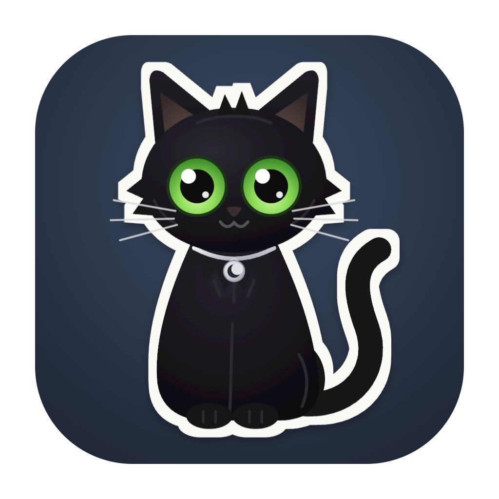
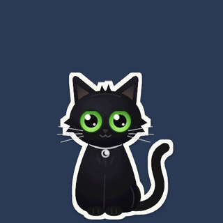
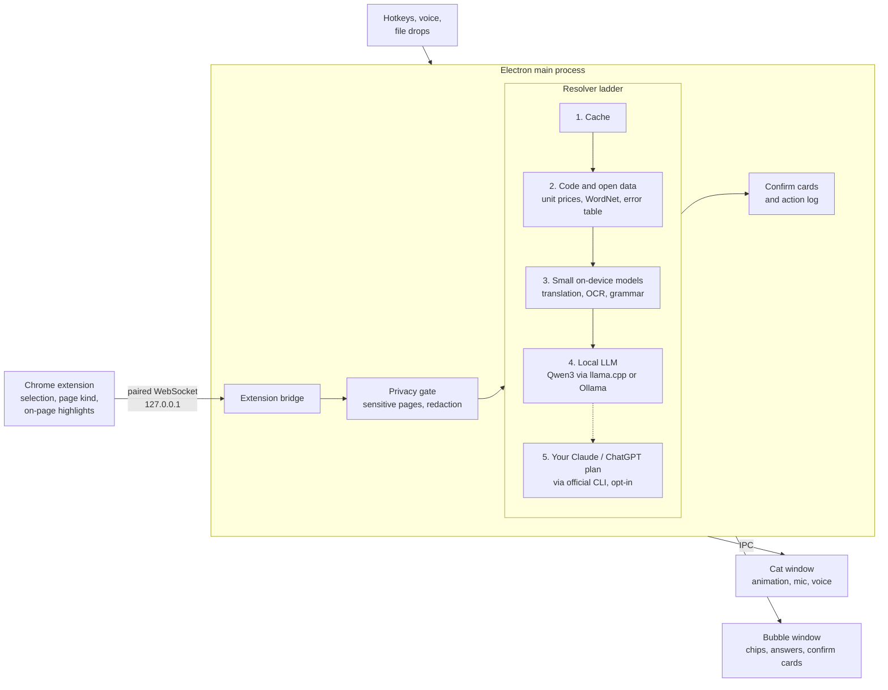

<p align="center">
  <a href="https://github.com/akankshyam07/loon/actions/workflows/selftest.yml"></a>
</p>

<p align="center">
  
</p>

<h1 align="center">Loon</h1>

<p align="center">
  <b>A tiny black cat who lives on your screen and helps you understand things.</b><br>
  Explain, compare, write and get stuff done, without leaving what you're doing.
</p>

<p align="center">
  <a href="LICENSE"></a>
  
  
  
</p>

<p align="center">
  
</p>

<p align="center"><a href="https://akankshyam07.github.io/loon/"><b>✧ Visit the Loon website ✧</b></a></p>

<p align="center"><i>"Private page detected. I'll look away unless you ask." — Loon</i></p>

Loon is a personal AI familiar: a little black cat with bright green eyes who sits in the corner of your screen, blinks
at you, follows your cursor, and naps when you're busy. Highlight something confusing, click the cat, or just talk to
it, and it helps right where you are.

**Contents:** [Why Loon](#why-loon) · [Features](#features) · [Quick start](#quick-start) ·
[How it works](#how-it-works) · [Privacy](#privacy) · [Tests](#tests) · [Roadmap](#roadmap) · [License](#license)

## Why Loon

- **Local-first.** The cat, its brain and its voice all run on your Mac. It keeps working offline after the first
  model download.
- **Free, with no API keys.** No account, no subscription, no cloud bill. Everything it uses is open source or open
  weights.
- **Private by default.** It only sees what you select or ask about, looks away on sensitive pages, and strips
  secrets before anything is processed.
- **Code first, model last.** Prices, unit conversions, rankings, dates, definitions and common errors are answered by
  plain code and open data. The language model only writes words, so Loon stays useful on a small local model and
  doesn't need a smart cloud LLM to get the numbers right.

## Features

**🐾 Be a cat.** Breathes, blinks, follows your cursor, naps, stretches, and reminds you about snacks and breaks. Now
and then it does something cool: moon magic, a pounce, peeking over the edge of your screen. Press and hold to pet it.

**💬 Explain and selection help**
- **Ask anything.** Click the cat or press **⌥Space**. Answers stream from a model running on your Mac.
- **Highlight help in Chrome.** Select a word and its definition appears instantly (WordNet); select foreign text
  and it's translated offline (Bergamot); select a stack trace and it's explained. Anything else gets a small paw
  you can click for Explain, Simplify, Summarize, Rewrite and more, so selecting text never throws a card at you.
- **⌥Space in any app.** Get the same help with text selected outside the browser.
- **Explain this page.** Key sentences highlighted right on the page, then a summary, notes or a checklist.
- **Screenshots.** Press **⌥⇧S**, pick a region, and Loon reads it (Tesseract OCR).
- **Drop a file on the cat.** PDFs, text, code, images (OCR) and CSVs (instant overview).

**🛒 Shopping and 🥗 food**
- **Shopping Cat.** Unit-price table, best value, warnings, review summary, and a compare basket across stores. Pure
  math, no model guessing at numbers.
- **Food Cat.** Lightest, highest-protein or likely-vegetarian picks, with tips like "dressing on the side". Calorie
  numbers only on request, always labelled as estimates.

**👩‍💻 Developer**
- Common errors and stack traces explained instantly from a curated table; the model is used only for unknown ones.
- JSON → Java or TypeScript types (quicktype), and code explanations.
- "Where did I leave off?" briefings for your projects, from git history, open TODOs and recent files.
- "Which companies ask this?" on LeetCode problems, from a local company-list repo you allow.

**✍️ Writing**
- Fix grammar (Harper, no model), make text shorter, more professional or warmer, and replace it in place.

**🗂️ Daily assistant and memory**
- "Remind me to call mom at 5", "add dentist Friday 3pm", "open Spotify", "find my resume", "run new note" (macOS
  Shortcuts). Each becomes a confirm card, and nothing happens until you click ✓.
- Notes are plain markdown in `~/Documents/Loon`. "What have I found?" sums up your saved notes, and "Quiz me" turns
  them into flashcards.
- **"What's my day?"** Today's Calendar events and due Reminders (read-only), plus "focus for 25 minutes" (the cat
  naps and stays quiet until the timer ends) and a gentle stretch nudge after an hour of non-stop work.
- **Memory you control.** "Remember that I'm vegetarian" and menu picks respect it. Memories live in one local
  SQLite file with full-text search: each request pulls only the few that match (about 4 ms even at 5,000 facts),
  boosted for the site you're on. "What did I look up about X?" searches your last 90 days of questions, and
  "what do you know about me?" lists everything. No model is involved in storing or finding memories, nothing is
  saved without your OK, and Privacy mode turns it all off.
- **Your local apps.** Connect apps running on your Mac that publish an OpenAPI description (FastAPI does by
  default), then ask them things in plain words. Reads run directly; anything that changes data asks first.
- **Moods.** Focus (the cat naps, no pop-ups), Privacy (no memory), and Judgmental (sass about prices and heavy food:
  *"this looks healthy, but the sauce is probably doing crimes"*).

**🎙️ Voice**
- Press **⌥⇧V** and talk. Loon listens until you pause, answers, and reads the first sentences aloud. Say "yes" to
  confirm, "stop" to interrupt. An optional "Hey Loon" wake word lives in Settings (off by default).
- Speech recognition (Moonshine), voice detection (Silero) and the voice itself (Kokoro) all run on your Mac.

**☁️ Use your Claude or ChatGPT plan (optional)**
- Want bigger-brain answers for "Go deeper" without paying for an API? In Settings → *Cloud via your plan*, pick
  Claude Code or Codex. Loon runs the official `claude` / `codex` CLI that you installed and signed into yourself,
  with every tool switched off, in an empty folder, after redacting secrets. Loon never touches your login. Off by
  default, always off in Privacy mode. Follow your provider's terms; it's meant for your own personal use.

## Quick start

**Requirements:** macOS on Apple Silicon, Node.js 20+, Google Chrome (for the browser features), and 2–6 GB of free
disk for the local model.

```bash
git clone https://github.com/akankshyam07/loon.git
cd loon
npm install
npm start
```

A black cat appears in the bottom-right corner of your screen. Say hi. 👋 It has no Dock icon; right-click the cat
for modes, size, Settings and **Quit Loon**.

On first use Loon offers to download its brain (Qwen3, Apache-2.0, about 1.8–5 GB depending on your RAM). Already run
[Ollama](https://ollama.com)? Loon uses it instead.

<details>
<summary>"Electron failed to install correctly"?</summary>

npm sometimes skips Electron's download. Run this, then `npm start` again:

```bash
node node_modules/electron/install.js
```
</details>

### Connect Chrome

1. Open `chrome://extensions`, turn on **Developer mode**, click **Load unpacked**, and pick the `extension/` folder.
2. Right-click the cat → **Pair browser…** to copy your pairing code.
3. Click the Loon extension icon and paste the code.

The extension only talks to the Loon app on your own computer (127.0.0.1), and only after pairing.

### Keyboard

| Keys | Does |
|---|---|
| ⌥Space | Ask Loon, or get help with text selected in any app (needs Accessibility permission) |
| ⌥⇧S | Explain a screenshot region (needs Screen Recording permission) |
| ⌥⇧V | Talk to Loon (needs Microphone permission; speech models download once, ~240 MB) |
| Esc | Close the bubble |

macOS asks for each permission only when you first use that feature.

<details>
<summary>Let your coding agent set it up</summary>

Loon ships with an [AGENTS.md](AGENTS.md) written for AI coding agents. Paste this into yours:

```text
Set up Loon (https://github.com/akankshyam07/loon) on my Mac. Clone it, read AGENTS.md,
and follow the Setup section step by step. Check my machine first, and tell me clearly
whenever I need to click something myself.
```
</details>

<details>
<summary>Build a .dmg</summary>

`npm run dist` builds `dist/Loon-<version>-arm64.dmg`. It isn't signed (that needs a paid Apple developer account), so
the first time: drag Loon to Applications, then right-click it → **Open** → **Open**.
</details>

## How it works

Every request climbs the same ladder and stops at the first rung that can answer it. The main process owns AI,
memory and actions; the cat and bubble windows only draw.



The bubble shows which rung answered and how many answers this week needed a model at all. More detail, including
the research behind each choice, is in [DESIGN.md](DESIGN.md).

## Privacy

- **It sees what you give it.** A selection, a page you ask about, a screenshot region you pick. Nothing is read in
  the background.
- **The cat looks away.** On bank, password and health pages Loon covers its eyes and reads nothing unless you click
  "Look anyway".
- **Secrets are stripped first.** Card numbers, IBANs, API keys, private keys and passwords are redacted before
  anything reaches a model or leaves the app.
- **Nothing happens behind your back.** Reminders, events, app launches and anything else that touches the world
  needs your ✓, and lands in an action log that records what happened, not what you wrote.
- **No cloud calls in the default path.** Settings, memory and notes stay on your Mac, and Privacy mode turns memory
  and the answer cache off.

## Tests

```bash
npm test          # unit tests, fast, no app or model needed
npm run selftest  # drives the real app, real model and real extension end to end
npm run demo      # the cat's idle routines on a fast timer, for animation work
```

`npm run selftest` opens real windows and needs a downloaded model; see [AGENTS.md](AGENTS.md) for details. The stack
is plain CommonJS with no build step: Electron for the cat, a Manifest V3 Chrome extension, and Node for the brain.

| Read this | To learn |
|---|---|
| [AGENTS.md](AGENTS.md) | setup, project map, house rules, how to test (great for humans too) |
| [CLAUDE.md](CLAUDE.md) | the product spec: what Loon is and how it should feel |
| [DESIGN.md](DESIGN.md) | how it's built, the decisions, and the research behind them |
| [THIRD_PARTY.md](THIRD_PARTY.md) | every open-source part and its license |

## Roadmap

- A signed and notarized app, so it opens without the right-click dance.
- Support for Intel Macs, then Windows and Linux.
- True hold-to-talk for voice, alongside the current press-to-talk.
- A lighter, always-on "Hey Loon" wake word model.
- Drafting email replies from the bubble.
- Meaning-based memory search (a small local embedding model) alongside full-text search.
- A "Remember this?" suggestion when you mention a preference.
- "Watch this page" alerts, for prices and changes.
- Spaced repetition for "Quiz me" flashcards.
- Even lower idle CPU for the cat's animations.

## Contributing

Issues and pull requests are very welcome, whether it's a bug, a new trick for the cat, or a better way to explain
things. A few house rules (more in [AGENTS.md](AGENTS.md)):

- Keep it local and private. No cloud calls in the default path.
- Code handles numbers; the model handles words.
- Anything that changes something outside Loon needs a confirm click.
- Run `npm test` before you open a PR.

## License

[MIT](LICENSE) for Loon's own code. Packaged builds include eSpeak NG (GPL-3.0) through the voice, so a distributed
`.dmg` follows GPL-3.0 as a whole; [THIRD_PARTY.md](THIRD_PARTY.md) has the details.

## Credits

Made by [Akankshya](https://github.com/akankshyam07), inspired by a real black cat with very green eyes.

Loon is a showcase of how far open tools can go: Electron · llama.cpp via node-llama-cpp · Qwen3 · sherpa-onnx ·
Moonshine · Silero VAD · Kokoro · Bergamot (Firefox Translations) · WordNet · Harper · Tesseract · Defuddle ·
quicktype · chrono · franc · linkedom · pdf.js · ws. Thank you to everyone who built them.

```
   /\_/\
  ( -.- )  zzz
   > ^ <    Loon is napping. Pet gently.
```
