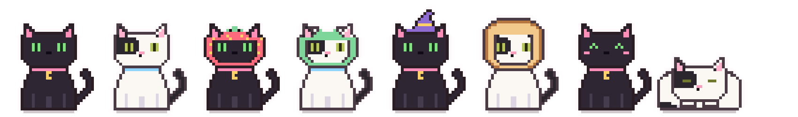
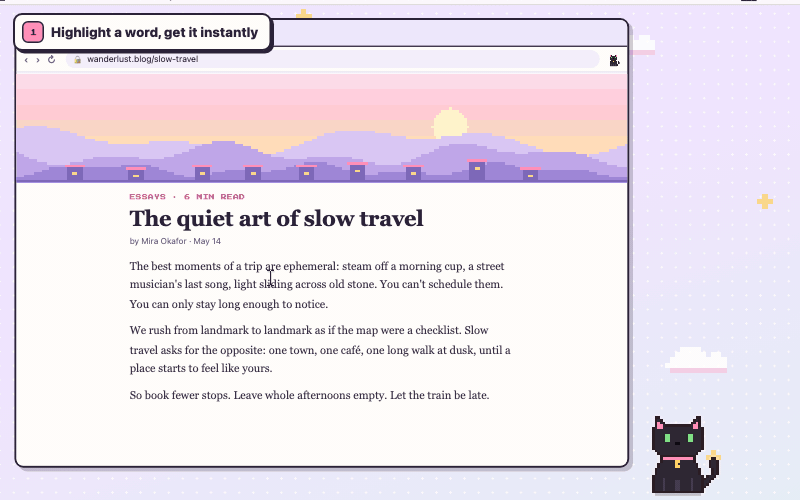
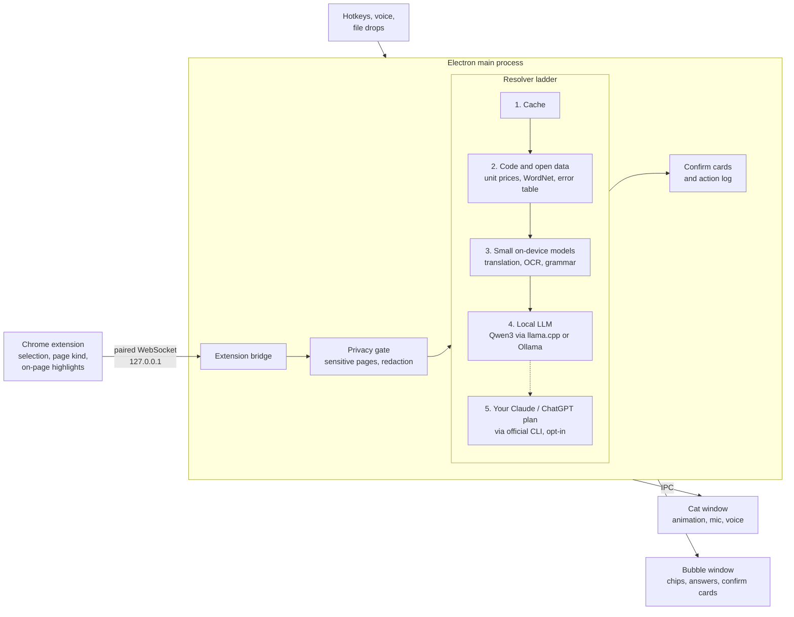

<p align="center">
  <a href="https://github.com/akankshyam07/loon/actions/workflows/selftest.yml"></a>
</p>

<p align="center">
  
</p>

<h1 align="center">Loon</h1>

<p align="center">
  <b>A tiny pixel cat who lives on your screen and helps you understand things.</b><br>
  Explain, compare, write and get stuff done, without leaving what you're doing.
</p>

<p align="center">
  Loon never acts without asking, shows what it used, and keeps everything on your Mac unless you turn something on.
</p>

<p align="center">
  <a href="LICENSE"></a>
  
  
  
</p>

<p align="center">
  <br>
  <a href="docs/demo.mp4"><b>▶ Watch the full demo (with sound)</b></a> · <a href="docs/loon-clip.mp4">10-second clip</a>
</p>

<p align="center"><a href="https://akankshyam07.github.io/loon/"><b>✧ Visit the Loon website ✧</b></a></p>

<p align="center"><i>"Private page detected. I'll look away unless you ask." — Loon</i></p>

Loon is a personal AI familiar: a little black cat with bright green eyes who sits in the corner of your screen, blinks
at you, follows your cursor, and naps when you're busy. Highlight something confusing, click the cat, or just talk to
it, and it helps right where you are.

The cat is a retro pixel sprite by default, animated frame by frame like a '90s handheld game. Pick your companion:

- **Luna**, the big sister: black fur, very green eyes, a moon pendant. A bit sassy, very smart, secretly sweet.
- **Soju**, the little brother: white with an eye patch and a freckled pink nose. Goofy, always hungry, adorable.

Personality only changes how they act and react, never how good the answers are: Luna grooms, judges and loafs;
Soju eats, sprawls belly-up, trips and bonks into the screen edge. With **Cameos** on, Luna calls Soju in when there's
food to judge and Soju fetches Luna for the brainy stuff. **Bring the other cat along** puts both on screen; they groom,
wrestle and nap together while you're idle and stop the moment you click or ask. Dress them up from the Wardrobe
(strawberry, frog and bee hoods, witch, Santa and party hats, a grad cap, a bow tie, sunglasses, a bread loaf), or
switch back to the smooth Classic style in Settings.

<p align="center">
  <br>
  <sub>The smooth Classic style, still one click away in Settings.</sub>
</p>

**Contents:** [Why Loon](#why-loon) · [Features](#features) · [Quick start](#quick-start) ·
[How it works](#how-it-works) · [Privacy](#privacy) · [Tests](#tests) · [Roadmap](#roadmap) · [License](#license)

## Why Loon

- **Local-first.** The cat, its brain and its voice all run on your Mac. It keeps working offline after the first
  model download.
- **Free, with no API keys.** No account, no subscription, no cloud bill. Everything it uses is open source or open
  weights.
- **Private by default.** It only sees what you select or ask about, looks away on sensitive pages, and strips
  secrets before anything is processed.
- **Code first, model last.** Prices, unit conversions, rankings, dates, definitions and common errors are answered by
  plain code and open data. The language model only writes words, so Loon stays useful on a small local model and
  doesn't need a smart cloud LLM to get the numbers right.
- **Smart when you want it, without a new bill.** A router rates every question easy, medium or hard. Easy stays on
  your Mac; medium and hard can go to the Claude or ChatGPT plan you already pay for, through their official apps,
  with first words in about half a second. Never API billing unless you pick a key yourself.

## Features

**🐾 Be a cat.** Breathes, blinks, follows your cursor, naps, stretches, and reminds you about snacks and breaks. Now
and then it does something cool: moon magic, a pounce, peeking over the edge of your screen. Press and hold to pet it.

**💬 Explain and selection help**
- **Ask anything.** Click the cat or press **⌥Space**. Answers stream from your Mac (or your plan, if you set it up),
  and every answer says where it came from. Follow-ups remember the conversation: "and in Python?" or "make it
  shorter" carries the earlier question, answer and selection to whoever answers next.
- **Honest, not flattering.** Loon never opens with "Great question!" or "You're absolutely right" and says so
  plainly when you're wrong. A small filter also trims that kind of opener from model answers.
- **Highlight help in Chrome.** Select a word and its definition appears instantly (WordNet); select foreign text
  and it's translated offline (Bergamot); select a stack trace and it's explained. Anything else gets a small paw
  you can click for Explain, Simplify, Summarize, Rewrite and more, so selecting text never throws a card at you.
- **⌥Space in any app.** Get the same help with text selected outside the browser.
- **Explain this page.** Key sentences highlighted right on the page, then a summary, notes or a checklist.
- **Ask about anything on your screen.** Type "what do you see?" or "is this a good deal?" and Loon looks at the
  window in front, whether it's Safari, a PDF, Slack or Chrome without the extension. It reads the text on your Mac,
  only when you ask, and throws the picture away right after. The first time, it asks before it looks.
- **Screenshots.** Press **⌥⇧S**, pick a region, and Loon reads it (Tesseract OCR).
- **Drop a file on the cat.** PDFs, text, code, images (OCR) and CSVs (instant overview).

**🛒 Shopping and 🥗 food**
- **Shopping Cat.** Unit-price table, best value, warnings, review summary, and a compare basket across stores. Pure
  math, no model guessing at numbers.
- **Food Cat.** Lightest, highest-protein or likely-vegetarian picks, with tips like "dressing on the side". Calorie
  numbers only on request, always labelled as estimates.

**👩‍💻 Developer**
- Common errors and stack traces explained instantly from a curated table; the model is used only for unknown ones.
- JSON → Java or TypeScript types (quicktype), and code explanations.
- "Where did I leave off?" briefings for your projects, from git history, open TODOs and recent files.
- "Which companies ask this?" on LeetCode problems, from a local company-list repo you allow.

**✍️ Writing**
- Fix grammar (Harper, no model), make text shorter, more professional or warmer, and replace it in place.

**🗂️ Daily assistant and memory**
- "Remind me to call mom at 5", "add dentist Friday 3pm", "open Spotify", "find my resume", "run new note" (macOS
  Shortcuts). Each becomes a confirm card, and nothing happens until you click ✓.
- Notes are plain markdown in `~/Documents/Loon`. "What have I found?" sums up your saved notes, and "Quiz me" turns
  them into flashcards.
- **"What's my day?"** Today's Calendar events and due Reminders (read-only), plus "focus for 25 minutes" (the cat
  naps and stays quiet until the timer ends) and a gentle stretch nudge after an hour of non-stop work.
- **Routines.** "Every weekday at 8:30 summarize my calendar", "remind me to drink water every 2 hours between 10
  and 6", "every Friday at 5 summarize what I worked on this week", "every Monday check the price of this page",
  "in 20 minutes remind me to stretch". Read without a model, saved only after you click ✓, and delivered as the
  cat's little "?" (or a macOS notification for reminders, if you turn that on). They respect quiet hours, wait out
  Focus mode, catch up once after your Mac sleeps instead of piling up, and price watches only speak up on a real
  drop. "Show my routines", "pause the water reminder", or manage them in Settings → Routines.
- **Memory you control.** "Remember that I'm vegetarian" and menu picks respect it. Memories live in one local
  SQLite file with full-text search: each request pulls only the few that match (about 4 ms even at 5,000 facts),
  boosted for the site you're on. "What did I look up about X?" searches your last 90 days of questions, and
  "what do you know about me?" lists everything. No model is involved in storing or finding memories, nothing is
  saved without your OK, and Privacy mode turns it all off.
- **Your memory is a folder you can open.** Loon keeps a readable copy of what it remembers as Markdown files in
  `~/Documents/Loon/Memory`. There is one file per topic, person and project, linked so the folder opens as an
  Obsidian vault. Edit or delete a line and Loon follows. If you and Loon both change the same memory, it keeps both
  and asks you to pick. Turn it off in Settings → Memory.
- **Your local apps.** Connect apps running on your Mac that publish an OpenAPI description (FastAPI does by
  default), then ask them things in plain words. Reads run directly; anything that changes data asks first.
- **Works with MCP tools.** Add MCP servers in Settings → Tools (MCP), on your Mac or over https, then ask with the
  server's name, like "github: my open issues". Read-only tools run directly. Anything else shows you the tool and
  its details first, and every call lands in the action log. Tokens are stored encrypted with the macOS Keychain.
- **Moods.** Focus (the cat naps, no pop-ups), Privacy (no memory), and Judgmental (sass about prices and heavy food:
  *"this looks healthy, but the sauce is probably doing crimes"*).

**🤖 Does it for you**
- "Search YouTube for lofi and play the first one", "open Notes and make a new note saying milk and eggs", "fill this
  form with my details". Loon clicks, types, scrolls and uses menus step by step, outlining each target on the page.
- Every change shows a card first (✓ Do it, ⏭ Skip, ✕ Stop). Buy, pay, delete and send always need their own click.
  It never types into password, card or one-time-code fields, ends the task on private pages, and Esc stops it.

**👆 Teach me on my screen**
- "Where is the Export button?", "show me how to export as PDF", "explain what I'm looking at", or **⌥⇧T**: Loon
  draws pixel callouts right on your screen (boxes, chunky arrows, numbered steps, a pointing cat) and never clicks
  anything itself. Next walks through the steps; Esc, ✕ or a click on the cat clears them.
- **Follow along with video tutorials.** Turn on captions in YouTube, say "follow along", and Loon reads what the
  video just said ("click File, then Export…") and points at each item in your own app, one step at a time.
- Grounding is plain code: on-device OCR with word boxes, plus exact element boxes from the Chrome extension. Simple
  "where is…" questions need no model at all; otherwise a model only picks from a numbered list of what's on screen,
  so every box lands on something real. It looks only when you ask, keeps no screenshots, redacts screen text before
  any cloud call, and refuses while a password manager, bank or private page is open. Sending the picture itself to
  your plan or API key is a separate switch, off by default.

**🧠 Personal, with a brain you can see**
- Custom instructions ("About you", "How Loon should reply"), reply length, tone and emoji, and a "Remember this?"
  chip when you mention a preference. Say "less emoji" and it sticks.
- **Get to know you:** on first run Luna asks five optional questions (what to call you, what you do, reply style,
  food rules, interests) while Soju reacts, then you review exactly what gets remembered.
- 👍 / 👎 on any answer. Ratings stay on your Mac (no answer text unless you opt in), and a run of 👎 on long
  answers gets a "Shorter answers by default?" chip. Nothing changes without your click.
- "Remember this" and "Forget what you used" on every answer, and a "Loon remembered…" toast with Undo whenever
  anything is saved.
- **History:** search past conversations in Settings, read them, and Continue one right where you left off. Or
  "Save this chat" as a markdown note. 90 days, local, never in Privacy mode.
- **Modes by context:** Developer Cat on GitHub, Stack Overflow and localhost, Shopping Cat on stores, Food Cat on
  menus, Study Cat on articles, Work Cat in mail and docs. A tiny badge shows which; it only reorders the chips.
- Memories become a little graph of people, projects, sites and topics, grouped into domains like work, study,
  shopping and food. Answers follow the links ("what should I review for Acme" finds "Spring Boot confuses me"), and
  Settings → Loon's brain lets you explore, edit or forget any node.

**🎙️ Voice**
- Press **⌥⇧V** and talk. Loon listens until you pause, answers, and reads the first sentences aloud. Say "yes" to
  confirm, "stop" to interrupt. An optional "Hey Loon" wake word lives in Settings (off by default).
- Speech recognition (Moonshine), voice detection (Silero) and the voice itself (Kokoro) all run on your Mac.

**☁️ Use your Claude or ChatGPT plan (optional)**
- Want bigger-brain answers without paying for an API? In Settings → *Smarter answers*, pick
  Claude Code or Codex. Loon runs the official `claude` / `codex` CLI that you installed and signed into yourself,
  with every tool switched off, in an empty folder, after redacting secrets. Loon never touches your login, and it
  refuses to run if the CLI is signed in with API billing. Off by default, always off in Privacy mode and on private
  pages. Follow your provider's terms; it's meant for your own personal use.
- Once it's set up, *Answer with: Your plan* is the default: quick questions stay instant on your Mac, everything
  else goes to your plan (a fast model for normal questions, the strongest one for hard questions and "Go deeper").
  A Claude Code process waits ready in the background, so first words arrive in about half a second instead of two.
  Pick *This Mac* to use your plan only for the hard stuff. Optional *Quick take* shows the Mac's instant answer until
  your plan's arrives.
- Prefer pay-per-use? The same card has *Your own API key*: Anthropic, OpenAI, Gemini (which has a free tier) or any
  OpenAI-compatible endpoint (OpenRouter, Groq, LM Studio…). The key is encrypted in the macOS Keychain and never
  leaves Loon's main process. Also off by default, never used unless you pick it, and billed by your provider.

## Quick start

**Requirements:** macOS on Apple Silicon, Node.js 20+, Google Chrome (for the browser features), and 2–6 GB of free
disk for the local model.

```bash
git clone https://github.com/akankshyam07/loon.git
cd loon
npm install
npm start
```

A black cat appears in the bottom-right corner of your screen. Say hi. 👋 It has no Dock icon; right-click the cat
for modes, size, Settings and **Quit Loon**.

On first use Loon offers to download its brain (Qwen3, Apache-2.0, about 1.8–5 GB depending on your RAM). Already run
[Ollama](https://ollama.com)? Loon uses it instead.

### Which model?

Loon picks one for you based on your Mac's memory. You don't need to choose.

| Your Mac's memory | Model | Download |
|---|---|---|
| 8 GB | Qwen3 1.7B | 1.8 GB |
| 16 GB or 24 GB | Qwen3 4B | 2.5 GB |
| 32 GB or more | Qwen3 8B | 5.0 GB |

My recommended default is Qwen3 4B, the 16 GB pick. It's quick and gives good answers.
If you already use Ollama, Loon talks to it on your Mac and downloads nothing.

<details>
<summary>"Electron failed to install correctly"?</summary>

npm sometimes skips Electron's download. Run this, then `npm start` again:

```bash
node node_modules/electron/install.js
```
</details>

### Connect Chrome

1. Open `chrome://extensions`, turn on **Developer mode**, click **Load unpacked**, and pick the `extension/` folder.
2. Right-click the cat → **Pair browser…** to copy your pairing code.
3. Click the Loon extension icon and paste the code.

The extension only talks to the Loon app on your own computer (127.0.0.1), and only after pairing.

### Keyboard

| Keys | Does |
|---|---|
| ⌥Space | Ask Loon, or get help with text selected in any app (needs Accessibility permission) |
| ⌥⇧S | Explain a screenshot region (needs Screen Recording permission) |
| ⌥⇧T | Teach me on screen: point at things, follow a video tutorial (needs Screen Recording permission) |
| ⌥⇧V | Talk to Loon (needs Microphone permission; speech models download once, ~240 MB) |
| Esc | Close the bubble |

macOS asks for each permission only when you first use that feature.

<details>
<summary>Let your coding agent set it up</summary>

Loon ships with an [AGENTS.md](AGENTS.md) written for AI coding agents. Paste this into yours:

```text
Set up Loon (https://github.com/akankshyam07/loon) on my Mac. Clone it, read AGENTS.md,
and follow the Setup section step by step. Check my machine first, and tell me clearly
whenever I need to click something myself.
```
</details>

<details>
<summary>Build a .dmg</summary>

`npm run dist` builds `dist/Loon-<version>-arm64.dmg`. It isn't signed (that needs a paid Apple developer account), so
the first time: drag Loon to Applications, then right-click it → **Open** → **Open**.
</details>

## How it works

Every request climbs the same ladder and stops at the first rung that can answer it. The main process owns AI,
memory and actions; the cat and bubble windows only draw.



The bubble shows which rung answered and how many answers this week needed a model at all. More detail, including
the research behind each choice, is in [DESIGN.md](DESIGN.md).

## Privacy

- **It sees what you give it.** A selection, a page you ask about, a screenshot region you pick, the window in front
  when you ask what's on your screen, your screen when you ask it to point at something. Nothing is read in the
  background, and screenshots are never saved. Turn screen reading off in Settings any time.
- **The cat looks away.** On bank, password and health pages Loon covers its eyes and reads nothing unless you click
  "Look anyway".
- **Secrets are stripped first.** Card numbers, IBANs, API keys, private keys and passwords are redacted before
  anything reaches a model or leaves the app.
- **Nothing happens behind your back.** Reminders, events, app launches and anything else that touches the world
  needs your ✓, and lands in an action log that records what happened, not what you wrote.
- **No cloud calls in the default path.** Settings, memory and notes stay on your Mac, and Privacy mode turns memory
  and the answer cache off.

### What stays on your Mac

Everything below runs on your Mac. The Network column says when Loon itself goes online, and where to.

| Feature | Network? | When and where |
|---|---|---|
| Asking and answers | No | The local model (Qwen3 through llama.cpp) runs on your Mac. With Ollama, Loon talks to it at 127.0.0.1:11434 on your Mac. |
| Highlight help (define, explain, rewrite, fix grammar) | No | WordNet, Harper and the local model, all on your Mac. |
| Translation | Once per language pair | The first time you translate a language pair, Loon downloads that pair's Bergamot model from Mozilla's server (bergamot.s3.amazonaws.com) and keeps it. Translating is offline after that. |
| Voice | Once | "Set up voice" downloads the speech models (about 240 MB) from the sherpa-onnx releases on GitHub. The first time Loon talks back, it downloads the Kokoro voice (about 90 MB) from Hugging Face. Listening and speaking run on your Mac. |
| OCR and screenshots (⌥⇧S, file drops) | Once | The first OCR downloads Tesseract's English data (a few MB) from the jsDelivr CDN. Reading text runs on your Mac. A ⌥⇧S region is kept as a temporary file on your Mac only while that conversation is open, then deleted. It never leaves your Mac on its own. |
| Teach me on screen (⌥⇧T) | No, unless you turn on Smarter answers | OCR and the extension's element boxes, on your Mac. Screenshots stay in memory and are never saved. With Smarter answers on, only the redacted list of words on screen goes to your plan or API key. The picture itself goes only if you also turn on "Send screenshots to your plan/API for teaching" (off by default). Never in Privacy mode or while a private window is open. |
| Memory, history, notes and routines | No | One SQLite file in Loon's app folder and markdown notes in `~/Documents/Loon`. Price watches read the page through your Chrome extension, so Loon never fetches it. "Smarter memory" is an optional 37 MB model (BGE small) from Hugging Face, downloaded only when you click Download in Settings. |
| Shopping, food and developer helpers | No | Plain code on what's on the page. Project briefings run `git` on folders you allow. Error answers can include a Stack Overflow search link, which opens only if you click it. |
| Screen control ("Does it for you") | Only what you approve | Loon clicks and types in your apps after each ✓. If a step opens a website (like a YouTube search), your browser loads it like any link you click. |
| Chrome extension | Your Mac only | The extension talks to 127.0.0.1:47631 on your Mac, only after pairing. It makes no other connections. |
| Your local apps (OpenAPI) | Your Mac only | Only apps on 127.0.0.1 or localhost. Loon refuses any other address. |
| Ask in Claude, ChatGPT or Gemini (the ⋯ menu) | Only when you click | Copies a ready prompt (and the screenshot, if the answer was about one) to your clipboard and opens the site in your browser. You paste it yourself. |
| Smarter answers via your plan | Only when you turn it on | Runs your plan's official CLI (`claude` or `codex`), which talks to Anthropic or OpenAI. Secrets are redacted first. Never in Privacy mode or on private pages. |
| Your own API key | Only when you pick it | Sends the redacted prompt to the provider you chose (Anthropic, OpenAI, Gemini or the base URL you typed). Never in Privacy mode or on private pages. |
| Model downloads | Once, after you click | The Qwen3 model (1.8 to 5 GB) from Hugging Face, the first time you accept. Nothing if you use Ollama. |

Loon has no accounts, analytics, crash reporting or auto-update, so there's nothing else phoning home.

## Tests

```bash
npm test          # unit tests, fast, no app or model needed
npm run selftest  # drives the real app, real model and real extension end to end
npm run demo      # the cat's idle routines on a fast timer, for animation work
```

The full end-to-end selftest runs automatically on GitHub Actions (a macOS runner) on every push, so it never takes
over a contributor's screen: 183 unit tests and 144 end-to-end checks at the time of writing. Locally,
`npm run selftest` runs hidden and needs a downloaded model; see [AGENTS.md](AGENTS.md) for details. The stack
is plain CommonJS with no build step: Electron for the cat, a Manifest V3 Chrome extension, and Node for the brain.

| Read this | To learn |
|---|---|
| [AGENTS.md](AGENTS.md) | setup, project map, house rules, how to test (great for humans too) |
| [CLAUDE.md](CLAUDE.md) | the product spec: what Loon is and how it should feel |
| [DESIGN.md](DESIGN.md) | how it's built, the decisions, and the research behind them |
| [THIRD_PARTY.md](THIRD_PARTY.md) | every open-source part and its license |

## Roadmap

- A signed and notarized app, so it opens without the right-click dance.
- Support for Intel Macs, then Windows and Linux.
- True hold-to-talk for voice, alongside the current press-to-talk.
- A lighter, always-on "Hey Loon" wake word model.
- Drafting email replies from the bubble.
- A small local vision model (Qwen3-VL class) for richer "Teach me on my screen" explanations without sending any
  picture to the cloud.
- More duo moments for Luna and Soju, like a curled-up yin-yang nap.
- Voice checks in the automated end-to-end tests.
- "Watch this page" alerts, for prices and changes.
- Spaced repetition for "Quiz me" flashcards.
- Even lower idle CPU for the cat's animations.

## Contributing

Issues and pull requests are very welcome, whether it's a bug, a new trick for the cat, or a better way to explain
things. A few house rules (more in [AGENTS.md](AGENTS.md)):

- Keep it local and private. No cloud calls in the default path.
- Code handles numbers; the model handles words.
- Anything that changes something outside Loon needs a confirm click.
- Run `npm test` before you open a PR.

## License

[MIT](LICENSE) for Loon's own code. Packaged builds include eSpeak NG (GPL-3.0) through the voice, so a distributed
`.dmg` follows GPL-3.0 as a whole; [THIRD_PARTY.md](THIRD_PARTY.md) has the details. The demo video's chiptune, sound
effects and cat voices are original (synthesized by `demo/music.js` and `demo/voices.js`) and MIT too.

## Credits

Made by [Akankshya](https://github.com/akankshyam07), inspired by a real black cat with very green eyes.

Loon is a showcase of how far open tools can go: Electron · llama.cpp via node-llama-cpp · Qwen3 · sherpa-onnx ·
Moonshine · Silero VAD · Kokoro · Bergamot (Firefox Translations) · WordNet · Harper · Tesseract · Defuddle ·
quicktype · chrono · franc · linkedom · pdf.js · ws. Thank you to everyone who built them.

```
   /\_/\
  ( -.- )  zzz
   > ^ <    Loon is napping. Pet gently.
```
